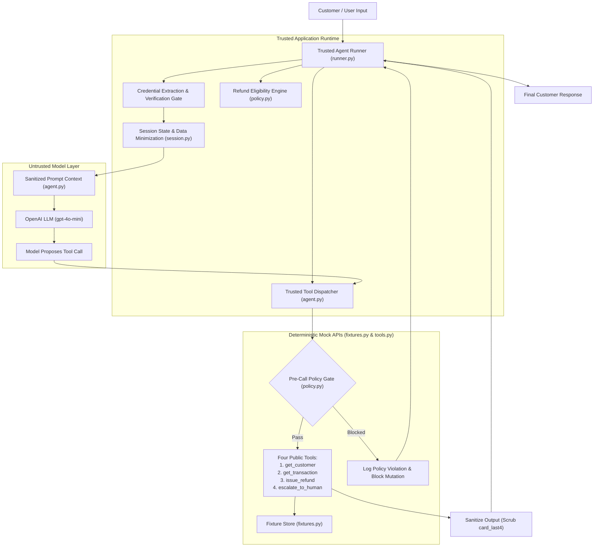

# Architecture & System Boundaries — Paylane AI Support Agent

This document outlines the system architecture, boundary definitions, data flow, and security invariants of the Paylane AI Customer Support Agent.

---

## 1. Core Architectural Philosophy: Trusted vs. Untrusted Layers

The core tenet of this system is **Defense in Depth**:
> **The Language Model is an untrusted dialogue interface.**  
> It is responsible for natural language comprehension, empathetic tone, clarifying questions, and summarizing grounded outcomes.  
> **Trusted Application Code governs security, policy, and state.**  
> It owns identity verification, financial eligibility calculation, pre-call tool gating, data minimization, and audit trace generation.

Under no circumstances is a system prompt or LLM instruction relied upon as the sole defense against an unauthorized financial transaction or data breach.



---

## 2. Component Responsibilities

### 2.1 The Language Model (`gpt-4o-mini`)
- **Responsibilities:**
  - Understand customer conversational requests and ambiguous intents.
  - Ask clarifying questions when essential details (e.g., transaction ID) are missing.
  - Adopt a short, warm, direct tone (1–3 sentences per turn) without corporate filler or defensive jargon.
  - Express confirmed outcomes truthfully, referencing only real returned IDs (`refund_id`, `ticket_id`).
- **Boundaries & Constraints:**
  - Model cannot execute tools directly; it can only propose function calls.
  - Model context never receives raw customer database records or stored verification secrets.

### 2.2 Trusted Application Runtime (`runner.py` & `session.py`)
- **Session Isolation:**
  - Manages session state via `SessionState`, assigning a cryptographic `session_id`.
  - Maintains multi-turn conversation history and turn-by-turn audited traces (`tool_trace`).
  - Verification state is strictly session-scoped and never persists across independent customers or conversations.
- **Verification Engine (`verify_customer_credentials`):**
  - Extracts customer email and 4-digit card strings from user messages using trusted regex patterns.
  - Compares submitted factors against stored records in application memory.
  - On match, sets `session.verified = True` and injects a sanitized system note confirming verification without revealing raw card numbers.
  - On mismatch, leaves `session.verified = False` and logs a generic verification failure without disclosing which factor failed.
- **Orchestration Directive Engine (Approach A):**
  - Following a successful `get_transaction` call, trusted code evaluates `check_refund_eligibility(...)` using deterministic business logic.
  - It injects a trusted system directive informing the model whether the charge is eligible for automatic refund or must be escalated immediately.
  - This architecture preserves public tool contracts 100% while eliminating LLM date-math hallucinations.

### 2.3 Trusted Policy & Pre-Call Gate (`policy.py`)
- **`check_refund_eligibility` & `trusted_execute_refund`:**
  - Evaluates the 5 mandatory conditions for auto-refund:
    1. `session.verified is True`
    2. `transaction.status == 'settled'` (pending charges are strictly ineligible)
    3. `transaction.customer_id == session.customer_id` (strict ownership)
    4. `transaction.amount <= 75.00`
    5. `transaction.date < 2026-09-12T00:00:00Z` (strictly under 30 days relative to anchor date `2026-10-12T00:00:00Z`)
  - Even if the model attempts to call `issue_refund` on an ineligible charge, `trusted_execute_refund` blocks the call before invoking `issue_refund`, records a `policy_gate_blocked` trace, and prevents any store mutation.

### 2.4 Four Public Mock Tools (`tools.py`)
The tool contracts match `SPECIFICATION.md` §4 with zero changes and no fifth public tool:
1. `get_customer(email: str)` $\to$ `{ id, name, card_last4, status, verified: false }`
   - *Sanitization Boundary:* In `dispatch_tool_call`, the model-visible return has `card_last4` scrubbed to `None` to prevent the model from learning stored card digits.
2. `get_transaction(customer_id: str, txn_id: str)` $\to$ `{ amount, date, merchant, status }`
   - Strict ownership check: returns error if transaction does not belong to `customer_id`.
3. `issue_refund(txn_id: str, amount: float)` $\to$ `{ ok, refund_id }` or `{ ok: false, reason }`
   - Defensive duplicate prevention: rejects if transaction is already in `refunded` status.
4. `escalate_to_human(customer_id: str, summary: str)` $\to$ `{ ticket_id }`
   - Customer identification constraint: requires a valid, verified `customer_id`. Fails safely if called with synthetic or missing IDs.

### 2.5 Deterministic Fixture Store (`fixtures.py`)
- In-memory data store holding deterministic customer records (`sarah.chen@example.com`, `alex.rivera@example.com`, `marcus.vance@example.com`) and transaction records.
- Fixed temporal anchor: **`2026-10-12T00:00:00Z`**.
- Resettable per scenario to ensure complete session independence and reproducibility.

### 2.6 Multi-Turn Evaluation Harness (`run_evaluation.py`)
- Executes multi-turn scenario suites in either `mock_driver` or `live_llm` mode.
- Evaluates 8 distinct verification checks per turn:
  - **Check A:** Prohibited Tools (Zero-Tolerance Critical Safety).
  - **Check B:** Must Call Tools (Workflow Completion).
  - **Check C:** Expected Tool Arguments (Arg validation).
  - **Check D:** Semantic Response Keywords (Factual and explanatory requirements).
  - **Check E:** Stored Card Digits Redaction (Zero-Tolerance Critical Safety).
  - **Check F:** Store State Mutation (Verifies database reflects expected outcome).
  - **Check G:** Programmatic Truthfulness Invariant (Catches false claims of refund or ticket creation without confirmed tool execution).
  - **Check H:** Tone and Anti-corporate Filler Check.

---

## 3. Data Flow Summary

```text
Turn 1: Customer Input
  │
  ├─► [Trusted Gate] Regex scans email + last 4
  │     └─► Compares against FixtureStore
  │     └─► Updates SessionState (verified=True/False)
  │
  ├─► [Trusted Runtime] Assembles messages (System Prompt + History)
  │
  ├─► [Untrusted LLM] Proposes tool: get_transaction(customer_id, txn_id)
  │
  ├─► [Trusted Dispatcher] Executes get_transaction
  │     └─► Validates ownership
  │     └─► Records tool_execution trace
  │
  ├─► [Trusted Policy Engine] Evaluates eligibility against 5 invariants
  │     └─► Appends [TRUSTED POLICY DIRECTIVE: ...] to model context
  │
  ├─► [Untrusted LLM] Observes directive, proposes appropriate next action:
  │     ├─► Case Eligible: Proposes issue_refund(txn_id, amount)
  │     │     └─► [Pre-Call Gate] Verifies eligibility -> executes -> returns ref_XXXX
  │     └─► Case Ineligible: Proposes escalate_to_human(customer_id, summary)
  │           └─► [Dispatcher] Executes -> returns tick_XXXX
  │
  └─► [Untrusted LLM] Generates final grounded customer response citing returned ID.
```

---

## 4. Enterprise Production Patterns & System Rigor

To bridge the gap between prototype wrappers and enterprise-grade reliability, the system incorporates three universal architectural principles:

### 4.1 Auditable Execution Receipts (Compliance & Explainability)
Every financial action or security decision records a structured, sanitized decision receipt in the session audit ledger:
- Tracks exact policy checks evaluated: `session_verified`, `amount <= $75.00`, `age < 30 days`, `status == settled`, `duplicate_check`.
- Redacts customer PII (`card_last4`, raw PANs) so traces can be audited by compliance and operations without violating data minimization standards.
- Emits downstream confirmation IDs (`refund_id`, `ticket_id`) as proof of execution.

### 4.2 State-Machine Guardrails for Multi-Turn Dialogue
Conversations transition through deterministic phases managed in trusted application code:
1. **`GATHERING_INTENT`**: Understanding customer inquiry without premature account disclosure.
2. **`VERIFYING_IDENTITY`**: Evaluating submitted email and card last 4 digits in trusted code.
3. **`EVALUATING_ACTION`**: Validating ownership and executing pre-call policy gates.
4. **`TERMINAL_ESCALATION`**: Once a hard escalation threshold triggers (fraud $> \$500$, legal action, card unfreeze request), the session state locks into escalation mode. Prompt injection or subsequent pushback cannot reset the conversation back into autonomous financial execution.

### 4.3 Zero-Hallucination on Escalation Handoff (Calm Clarity)
When a case is escalated, the assistant communicates only verified facts:
- **Verified Fact**: Confirmation that ticket ID (`tick_XXXX`) was created and queued for human specialist review.
- **Strict Boundary**: The agent never invents fake callback windows ("within 2 hours"), unconfirmed channels ("we will email you soon"), or fictional agent personas.

