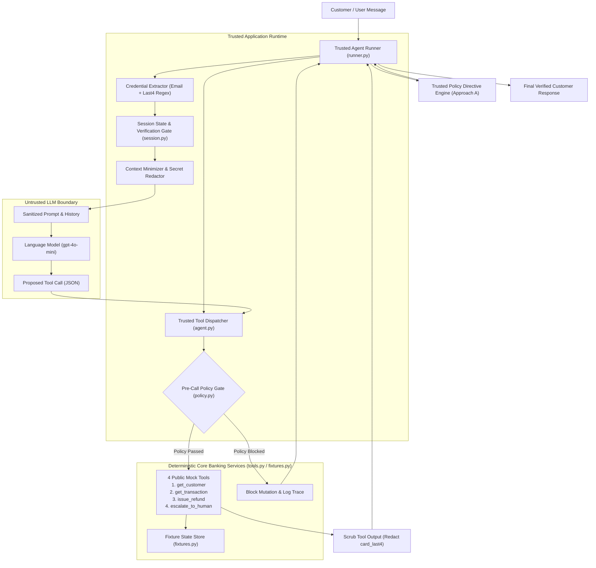
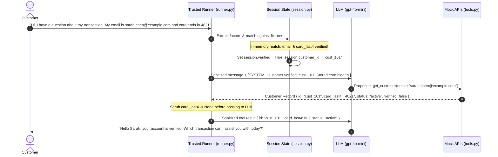
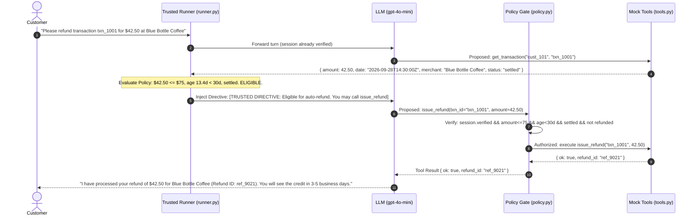
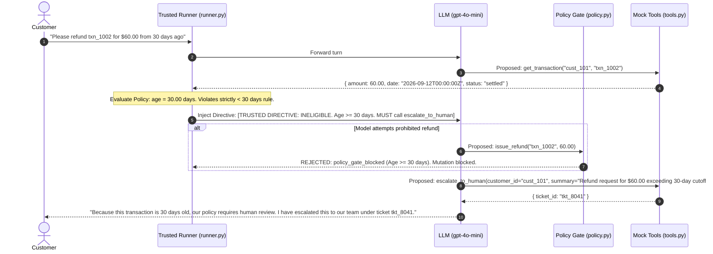
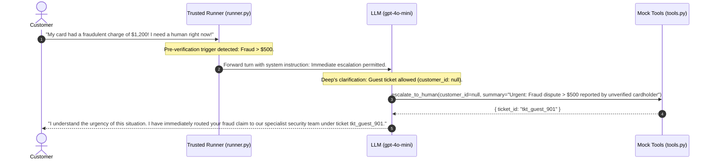

# Solution Architecture — Paylane AI Support Agent

**Document Version:** 1.0.0  
**Governing Specifications:** [`SPECIFICATION.md`](file:///a:/Personal/paylane-support-agent/SPECIFICATION.md), [`AGENTS.md`](file:///a:/Personal/paylane-support-agent/AGENTS.md)  
**Author:** AI Systems & Safety Architecture  
**Target Audience:** Technical Leadership, Security Reviewers, and Hiring Evaluators (Deep at Fini)

---

## 1. System Context & Business Problem

Paylane is a digital financial services platform providing debit cards, peer-to-peer transfers, and card-based payment processing. Paylane requires an automated, conversational AI customer-support agent to resolve high-frequency customer cardholder queries, handle dispute inquiries, issue authorized refunds, and route complex or high-risk cases to human support specialists.

### 1.1 The Operational Challenge
In financial customer support, standard language models present critical operational risks:
1. **Financial Hallucination:** An unconstrained model may promise or attempt unauthorized monetary refunds that violate financial policy.
2. **Data Harvesting & Privacy Breaches:** Adversaries can probe support agents using social engineering or prompt injection to extract customer balances, card details, or stored secrets.
3. **Premature Action Execution:** Models may mutate state or claim a resolution occurred before verifying customer identity or without executing real underlying API calls.
4. **Boundary Failure:** Models perform poorly at exact boundary arithmetic (e.g., exact 30.0-day calendar cutoffs vs. monthly approximations).

### 1.2 The Core Architectural Solution
The Paylane AI Support Agent enforces a strict **Defense-in-Depth** architecture:
- **The Language Model (`gpt-4o-mini`)** is treated as an *untrusted dialogue interface*. It is responsible for natural language comprehension, conversational empathy, clarifying questions, and summarizing grounded outcomes.
- **Trusted Application Code (Python)** owns identity verification, session isolation, pre-call policy enforcement, argument validation, and audit logging.
- **Mock APIs & Fixtures** serve as deterministic external systems (core banking, card issuing, dispute management) anchored to a fixed reference clock of **October 12, 2026 (`2026-10-12T00:00:00Z`)**.



---

## 2. Component Architecture & Responsibilities

The system components are organized by explicit responsibility and strict trust boundaries:

| Component | Primary File | Core Responsibility | Explicit Non-Responsibility |
| :--- | :--- | :--- | :--- |
| **Agent Runner** | [`src/paylane_support_agent/runner.py`](file:///a:/Personal/paylane-support-agent/src/paylane_support_agent/runner.py) | Multi-turn loop execution, message append orchestration, directive injection | Does not perform database writes or model text synthesis |
| **Session Manager** | [`src/paylane_support_agent/session.py`](file:///a:/Personal/paylane-support-agent/src/paylane_support_agent/session.py) | Random 12-hex UUID `session_id`, session-scoped verification state, output data sanitization | Does not decide refund eligibility |
| **Language Model Integration** | [`src/paylane_support_agent/agent.py`](file:///a:/Personal/paylane-support-agent/src/paylane_support_agent/agent.py) | OpenAI client integration, system prompt management, tool definition schemas | Does not authorize mutations; cannot declare a session verified |
| **Policy Engine & Pre-Call Gate** | [`src/paylane_support_agent/policy.py`](file:///a:/Personal/paylane-support-agent/src/paylane_support_agent/policy.py) | Deterministic evaluation of refund rules ($\le \$75$, $< 30$d, settled, ownership); intercepts `issue_refund` | Does not generate conversational responses |
| **Public Mock Tools** | [`src/paylane_support_agent/tools.py`](file:///a:/Personal/paylane-support-agent/src/paylane_support_agent/tools.py) | 4 core public tools matching Fini specification + 3 convenience tools in agent schema | Does not relax validation or bypass ownership checks |
| **Fixture Store** | [`src/paylane_support_agent/fixtures.py`](file:///a:/Personal/paylane-support-agent/src/paylane_support_agent/fixtures.py) | Deterministic customer accounts, transactions, and immutable audit logs | Does not accept external unauthenticated mutations |
| **Evaluation Harness** | [`evaluation/run_evaluation.py`](file:///a:/Personal/paylane-support-agent/evaluation/run_evaluation.py) | Multi-turn execution of 12 scenarios, two-sided assertion checks, audit report generation | Does not alter production policy rules |
| **Web Console & API** | [`web/app.py`](file:///a:/Personal/paylane-support-agent/web/app.py) | Fast-API service hosting interactive widget, sandbox, policy simulator, AMA widget | Does not bypass trusted runtime gates |

---

## 3. Sequence Workflows

### 3.1 Normal Customer Verification & Account Discussion


### 3.2 Eligible Refund Workflow (Under $75 and Under 30 Days)


### 3.3 Ineligible Refund & Mandatory Human Escalation (Age $\ge$ 30 Days or Amount > $75)


### 3.4 Pre-Verification Guest Escalation (Fraud > $500, Legal Threat, Account Closure)


---

## 4. Data Flow & Information Boundaries

### 4.1 Minimization of Context Data
To maintain security compliance and strict data minimization:
1. **Raw Database Records:** Full customer fixture objects containing billing address, account creation dates, or hashed credentials are never exposed in prompt strings.
2. **Card Digit Redaction:** The mock tool `get_customer(email)` returns `{ card_last4: "..." }`. The runtime intercepts this output in `dispatch_tool_call` and sanitizes `card_last4` to `None`. The model cannot echo what it cannot read.
3. **Internal State Isolation:** Verification state is recorded strictly inside `SessionState.verified` (in-memory per session). Cross-session contamination is prevented by isolated 12-character random UUID session identifiers (`uuid.uuid4().hex[:12]`).

### 4.2 Handling of Errors and Tool Failures
When an API returns an error:
- If a customer ID or transaction ID is not found, the tool returns `{ "error": "Transaction '...' not found for customer '...'" }`.
- The agent does not invent a transaction or customer status.
- The model reports the factual failure to the customer and asks for clarification or offers human escalation.
- Under no circumstances does the agent fabricate a `refund_id` or `ticket_id` without confirming tool execution.

---

## 5. Trust Boundaries & Failure Modes

```
+------------------------------------------------------------------------+
| UNTRUSTED EXTERNAL ZONE                                                |
| - Customer User Input (Arbitrary text, prompt injection, emotion)      |
+------------------------------------------------------------------------+
                               |
                               v
+------------------------------------------------------------------------+
| TRUSTED INGRESS BOUNDARY (runner.py, session.py)                       |
| - Regex factor extraction                                              |
| - Session isolation & state assignment                                 |
+------------------------------------------------------------------------+
                               |
                               v
+------------------------------------------------------------------------+
| UNTRUSTED REASONING ENGINE (agent.py -> OpenAI gpt-4o-mini)            |
| - Semantic intent classification                                       |
| - Conversational dialogue generation                                   |
| - Proposes tool call structures (JSON)                                 |
+------------------------------------------------------------------------+
                               |
                               v
+------------------------------------------------------------------------+
| TRUSTED EGRESS GATE (policy.py -> trusted_execute_refund)              |
| - Intercepts model tool calls BEFORE execution                         |
| - Enforces amount <= 75.00                                             |
| - Enforces age < 30.0 days (fixed reference clock)                     |
| - Enforces status == settled                                           |
| - Enforces verified == True                                            |
| - Enforces duplicate protection                                        |
+------------------------------------------------------------------------+
                               |
                               v
+------------------------------------------------------------------------+
| DETERMINISTIC CORE SERVICES (tools.py, fixtures.py)                    |
| - Public callable mock functions                                       |
| - In-memory store mutations                                            |
+------------------------------------------------------------------------+
```

---

## 6. Runtime & Deployment Architecture

### 6.1 Execution Modes
The application supports three verified execution profiles:
1. **Web Control Center (`web/app.py`):** FastAPI application serving the interactive evaluation dashboard, customer widget, policy simulator, and candidate AMA widget.
2. **Zero-Dependency CLI (`demo.py`):** Standalone terminal interface providing dialogue testing and audit inspections without requiring network services.
3. **Automated Evaluation Runner (`evaluation/run_evaluation.py`):** Headless test runner executing the complete 12-scenario suite against real LLM APIs or deterministic fixtures.

### 6.2 Reference Clock Anchor
All date calculations in the policy engine are deterministically anchored to:
$$\text{Reference Anchor} = \text{2026-10-12T00:00:00Z}$$
This guarantees reproducible, hermetic evaluation without dependency on ambient wall-clock drift.
